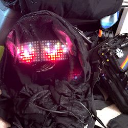

# flame-eyes-beetle
Arduino Sketch to animate a pair of flaming eyes on a 8x32 adressable LED grid. Optimized to run on the DFRobot Beetle Arduino variant

This repo includes the Arduino source code and a reference file to animate a pair of "flaming" eyes on an 8x32 matrix of addressable LEDs. At random intervals the eyes will appear to "blink" on the screen.

The timing constants in the code are optimized for the very small DFRobot "Beetle" variant board, which is equivalent to the Leonardo version of the Arduino. 
It uses IO Pin 9 as the data bin for the LED array.

Timing for the speed at which the "flames" flicker is governed by the unsigned int variable **tempo** . To increase the flicker rate reduce the value of **tempo**

Note that the video shown in this readme was using the relatively fast flicker rate of *tempo = 8*

Libraries you will need to have installed in your Arduino IDE:

  * Flash.h
  * EEPROM.h
  * Adafruit_GFX.h
  * Adafruit_NeoMatrix.h
  * Adafruit_NeoPixel.h

  In adition you will note that the source code explicitly includes the definitions file **WS28212_Definition.h** which is included in the source code folder of this repo
